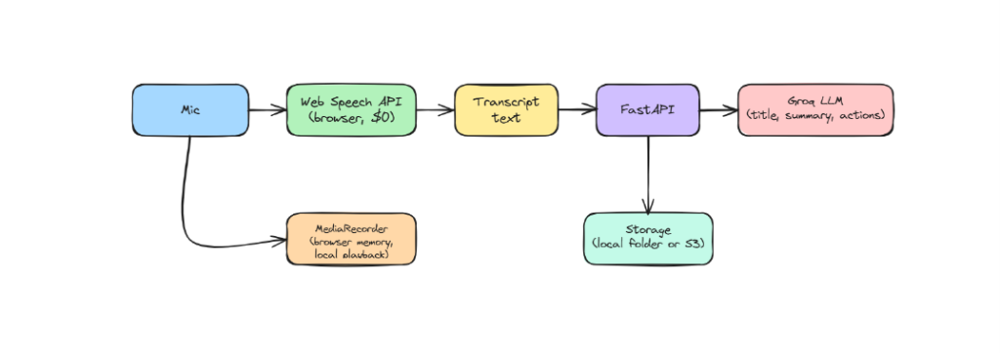

# Engineering Intent & Learning Guide: meeco

This document explains **why** `meeco` is built the way it is and maps out a **beginner-friendly build plan starting WITHOUT AssemblyAI first**.

---

## 1. Why Start Without AssemblyAI? (Phase 1 vs. Phase 2)

Trying to build real-time WebSocket audio streaming, binary Ogg Opus chunking, and distributed timeline repair on Day 1 overwhelms beginner engineers before they ever touch an LLM.

Instead, `meeco` splits cleanly into two phases:

### Phase 1 (Start Here): Browser Web Speech + FastAPI + Groq LLM

- **Transcription costs $0** and needs zero audio streaming infrastructure: the browser's `SpeechRecognition` API transcribes speech live as captions.
- **Your engineers focus 100% on core AI + full-stack skills:** speech API edge cases, prompt design, structured JSON extraction, LLM retry/fallback handling, token budgeting, and stateless backend persistence.
- **No backend route changes needed:** `POST /v1/sessions/{sid}/finalize` already skips batch ASR whenever `owned` covers the whole recording (`[[0, duration_ms]]`), and `TRANSCRIBER=fake` in `.env` requires no AssemblyAI key.

### Phase 2 (Upgrade Later): Why AssemblyAI + S3 Exists in the Architecture
Once Phase 1 works, you will quickly run into Web Speech's real-world limits:
1. It does not work in Firefox (`SpeechRecognition` is missing).
2. If Chrome drops during silence or a network hiccup, missed words cannot be recovered from the recorded `Blob`.
3. Multi-hour meetings need `voice_focus` noise suppression and server-controlled accuracy.

Phase 2 replaces Web Speech with a **dual-path audio pipeline** (`LiveStream` WebSocket + `ChunkUploader` 30 s S3 chunks + `ledger.py` gap repair) so clean sessions still skip batch ASR while dropped sockets repair only missing seconds.

---

## 2. Core AI & Engineering Lessons in Phase 1

1. **Prompt & Output Engineering (`llm.py`):** LLMs don't always obey `"JSON only"`—they wrap output in markdown fences or hit rate limits (`429`). Teach your code to clean fences (`_json_from`), enforce language matching, cap prompt tokens (`MAX_CHARS`, `head_tokens`), and fall back gracefully (`openai/gpt-oss-120b` when a primary Llama model is refused).
2. **Latency Hiding & Caching (`sessions.py`):** Cache `summary` and `action_items` on the stored transcript JSON so revisiting tabs is instant (`refresh=true` forces regeneration). Use deterministic fallbacks (`clean_title`) if a title call fails so a recording never breaks.
3. **Resilient Browser Speech (`transcriber.js`):** Real browser APIs are messy—Chrome silently kills `continuous` speech recognition on pauses, so your provider must auto-restart seamlessly and fall back cleanly when unsupported.
4. **Stateless Backend (`LocalStorage` / `S3Storage`):** Never keep sessions in Python dicts or local SQLite. Store every session under `X-Device-Id` via the `Storage` interface so the same FastAPI app deploys straight to AWS Lambda.
5. **Test Without Keys First (`FakeLLM`):** Write deterministic local heuristics (`FakeLLM`) so your entire API and frontend flow can be tested with zero Groq spend before adding `GROQ_API_KEY`.

---

## 3. Repository Restriction Plan (Phase 1 Starter Repo)

To run Phase 1 without AssemblyAI, keep all UI, storage, config, and Phase 2 audio/streaming plumbing intact (or stubbed), and restrict just the **5 core Phase 1 files** for your two beginners to build:

### Provided in the Starter Repo (Already Working)
- **UI & Hooks:** `frontend/src/App.jsx`, `components/*`, `hooks/usePlayer.js`, `hooks/useRecorder.js`, `styles.css`, `vite.config.js`, `package.json`
- **Client Utilities:** `frontend/src/lib/{api,cloud,config,empty,format,meter,pdf,storage,wav}.js`
- **Backend Shell & Storage:** `backend/app/{main,config,deps,models}.py`, `backend/app/routes/*`, `backend/app/services/storage.py`, `backend/lambda_handler.py`, `backend/scripts/*`, `backend/.env.example`
- **Pre-built / Phase 2 Infrastructure (Keep Provided so Imports & Tests Don't Break):**
  - `backend/app/ledger.py`, `backend/app/audio.py`, `backend/app/services/transcribe.py` (`FakeTranscriber` handles `TRANSCRIBER=fake` out of the box)
  - `frontend/src/lib/{pcm-worklet,oggOpus,chunker,liveStream,intervals}.js`
- **Tests:** `frontend/test/*`, `backend/tests/*`, `e2e/*`

### Restricted From Push (What the Two Beginners Build in Phase 1)

| Owner | File | What They Build |
| --- | --- | --- |
| **Engineer A (Client)** | `frontend/src/lib/transcriber.js` | Web Speech API live recognizer with Chrome silence auto-restart, fatal error handling, flush timeout, and demo fallback |
| **Engineer A (Client)** | `frontend/src/lib/mockActions.js` | Offline heuristic `summarise()` & `getActionItems()` for standalone mode when no backend URL is set |
| **Engineer A (Client)** | `frontend/src/lib/cloudEngine.js` *(Phase 1 Web Speech bridge)* | Instead of streaming to AssemblyAI, capture via Web Speech + `MediaRecorder` and submit `{ duration_ms, owned: [[0, duration_ms]], turns }` to `/v1/sessions/{sid}/finalize` |
| **Engineer B (Backend)** | `backend/app/services/llm.py` | `FakeLLM` (no-key dev double) + `GroqLLM` (`title`, `summary`, `action_items`, `_json_from`, backoff retries, model fallback) |
| **Engineer B (Backend)** | `backend/app/services/sessions.py` | `SessionService` (`create`, `finalize`, `summary`, `action_items`, `set_action_items`, `list`, `get`, `delete`) using `Storage` and `LLM` |

*(Note: Engineer A can implement the Web Speech -> backend bridge either as a lightweight `cloudEngine.js` or cleanly inside `useRecorder.js` / `App.jsx`. Keeping `cloudEngine.js` as the Phase 1 bridge keeps the rest of `useRecorder.js` untouched!)*

---

## 4. Phase 1 Build Roadmap (1-Week Beginner Sprint)

1. **Day 1 — Setup & Standalone Mode (Both):**
   - Inspect [`models.py`](backend/app/models.py), [`routes/sessions.py`](backend/app/routes/sessions.py), and [`api.js`](frontend/src/lib/api.js).
   - Engineer A builds `transcriber.js` + `mockActions.js` and tests live microphone captions in Chrome/Edge at `http://localhost:5173/`.
   - Engineer B builds `FakeLLM` in `llm.py` and the basic CRUD/finalize methods in `sessions.py` (with `TRANSCRIBER=fake`).

2. **Day 2–3 — Real Groq LLM & API Tests (Engineer B):**
   - Implement `GroqLLM` in `llm.py`: structured prompts, JSON mode, fence parsing, `429`/`5xx` retries, and `openai/gpt-oss-120b` fallback.
   - Verify with `pytest tests/test_providers.py -k "groq or title"` and `pytest tests/test_api.py -k "device or unknown or happy_path or history"`.

3. **Day 3–4 — Connect Web Speech to Groq Backend (Engineer A):**
   - Implement the Phase 1 `cloudEngine.js` bridge: run `createTranscriber()` during recording, keep `MediaRecorder` running locally if desired, and on Stop call `api.createSession()` -> `api.finalize(sid, { duration_ms, owned: [[0, duration_ms]], turns: [...] })`.
   - Test end-to-end locally at `http://localhost:5173/?api=http://localhost:8000` with real speech -> Groq summary & action items -> PDF export -> history reload.

4. **Day 5 — Prompt Tuning & Eval (Both):**
   - Test edge cases: empty/short recordings (`< 1 s`), non-English speech, transcripts with zero action items, long transcripts (`MAX_CHARS`), and bad network responses.
   - *(Optional Phase 2 Next Sprint)*: Replace the Phase 1 `cloudEngine.js` bridge with the full AssemblyAI streaming + S3 chunk repair design documented in [PRD.md §5](PRD.md).
