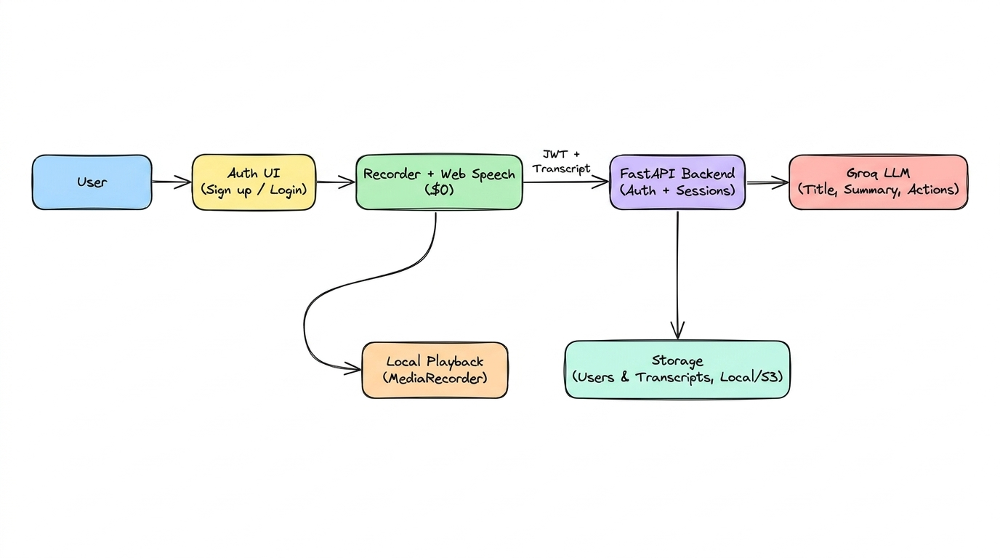

# Project Brief: meeco (Frontend & Backend Overview)

**meeco** is a mobile-first voice-to-text and AI productivity web application. Users create an account, record audio, get real-time transcription in the browser, and use AI to generate titles, summaries, action items, and shareable PDFs—backed by a stateless API.

*(See [PRD.md](./PRD.md) and [INTENT.md](./INTENT.md) for deeper technical invariants and the Phase 2 AssemblyAI upgrade path.)*

---

## System Overview (Phase 1)

In Phase 1, transcription runs directly in the browser using the **Web Speech API ($0)** while **FastAPI + Groq LLM** handles user accounts, session persistence, and AI post-processing.

---

## Frontend Description (TypeScript + React + Vite)

### Role & Goal
Rebuild the entire client user interface from scratch in **strict TypeScript**, add the **authentication workflow**, and connect browser-based live transcription to the backend API—while keeping the dark glassmorphic mobile design language provided in `frontend/src/styles.css`.

### What the Frontend Covers
- **TypeScript Architecture:** Set up strict TypeScript (`tsconfig.json`, domain types, typed API client, and `tsc --noEmit` checking) across the React + Vite application.
- **Authentication Workflow:**
  - Sign Up (Name, Email, Password) and Sign In screens matching the app's dark glassmorphic shell.
  - Persistent authenticated session state (JWT token handling, automatic session restore on refresh, Sign Out, and graceful redirect to Sign In on expired/unauthorized `401` responses).
  - Profile view displaying the signed-in user's details, recording stats, and Sign Out action.
- **Recording & Live Browser Transcription:**
  - Microphone capture with real-time 9-bar waveform visualization and timer.
  - Live captions powered by the browser's Web Speech API (`SpeechRecognition`), including silent-pause recovery and clear fallback handling on unsupported browsers.
  - Local audio recording (`MediaRecorder`) for immediate playback of the most recent recording.
- **Results, AI Actions, History & Export:**
  - Processing ring transition and tabbed Result view (`Transcript | Summary | Action items`).
  - On-demand Summary and Action Items requests to the backend with loading skeletons, explicit error feedback, and interactive action-item checkboxes synced to the server.
  - User-scoped recording History list (lazy-loading transcripts, delete/clear) and client-side A4 PDF export/sharing.
  - Standalone fallback mode when no backend API URL is configured.

### Provided Reference & Shell Assets
- `frontend/src/styles.css` (complete dark UI theme, layout shell, animations, and responsive mobile frame)
- `frontend/index.html`, `frontend/vite.config.js`, `frontend/package.json`
- Utility references in `frontend/src/lib/` (`api.js`, `config.js`, `format.js`, `meter.js`, `pdf.js`, `storage.js`, `wav.js`)

---

## Backend Description (FastAPI + Auth + Groq LLM + Object Storage)

### Role & Goal
Build a **stateless, database-free FastAPI backend** that manages user authentication via **Email + Password + JWT**, persists user-scoped transcripts in object storage (`LocalStorage` in dev, `S3Storage` in production / AWS Lambda), and powers AI features via **Groq LLM** without requiring AssemblyAI in Phase 1.

### What the Backend Covers
- **Stateless Authentication Workflow:**
  - Registration (`POST /v1/auth/register`), Login (`POST /v1/auth/login`), and Current User (`GET /v1/auth/me`) endpoints using Email + Password and signed JWT Bearer tokens.
  - Secure password hashing (salted hash + constant-time verification) and user storage built directly on the existing `Storage` interface (`LocalStorage` / `S3Storage`)—no external database needed.
  - Protect all `/v1/sessions*` routes with JWT verification (`401` when missing/invalid/expired), replacing anonymous `X-Device-Id` scoping and enabling `"Authorization"` in CORS headers.
- **User-Scoped Session Lifecycle:**
  - Create, finalize, list, fetch, and delete recording sessions strictly isolated per authenticated user.
  - Accept finalized browser transcripts directly on `/finalize` (skipping batch ASR when the transcript already covers the recording duration), store full transcript documents plus compact history metadata rows, and support idempotent retries.
- **Groq LLM Post-Processing:**
  - Language-matched short titles (`<= 6` words), structured JSON summaries (`overview` + `points`), and checkable `action_items` extraction (plus checkbox state persistence).
  - Resilient LLM calling (rate-limit/transient retries, JSON fence extraction, model fallback to `openai/gpt-oss-120b`) alongside deterministic `FakeLLM` doubles so tests and local dev work with zero API keys.
- **Verification:** Automated `pytest` coverage for auth, cross-user isolation, Groq mocking/fallbacks, and session lifecycle.

### Provided Infrastructure & Contracts
- App entrypoint, settings, CORS, and Lambda adapter (`backend/app/main.py`, `config.py`, `models.py`, `lambda_handler.py`)
- Storage abstraction (`backend/app/services/storage.py` for local disk and S3)
- Route wiring (`backend/app/routes/sessions.py`, `misc.py`) and Phase 2 audio/ledger helpers (`ledger.py`, `audio.py`, `transcribe.py`)
- Existing `pytest` suite (`backend/tests/*`) and AWS S3/Lambda deploy scripts (`backend/scripts/*`)

---

## Shared API Boundary

Both engineers integrate around these boundaries (internal implementation details are up to each engineer):

| Area | Contract |
| --- | --- |
| **Auth Header** | `Authorization: Bearer <jwt_token>` on all protected routes; `401` on invalid/expired token |
| **Auth Routes** | `POST /v1/auth/register`, `POST /v1/auth/login`, `GET /v1/auth/me` -> `{ access_token, token_type: "bearer", user: { id, name, email, created_at } }` |
| **Session Routes** | `POST /v1/sessions`, `POST /v1/sessions/{sid}/finalize`, `GET /v1/sessions`, `GET /v1/sessions/{sid}`, `DELETE /v1/sessions/{sid}` |
| **AI Action Routes** | `POST /v1/sessions/{sid}/summary`, `POST /v1/sessions/{sid}/action-items`, `PUT /v1/sessions/{sid}/action-items` |
